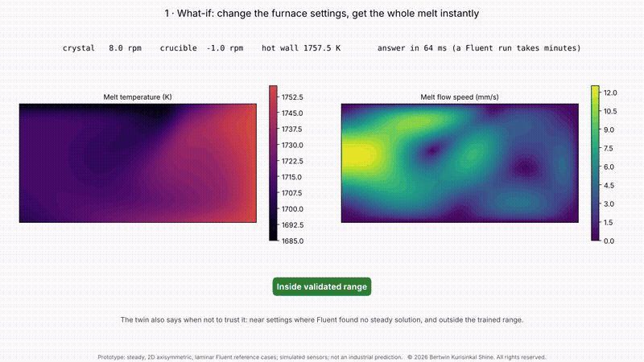

# CZ Digital Twin

A digital twin of the silicon melt in a Czochralski (CZ) crystal puller, built on 254 ANSYS Fluent simulations.

Given the furnace settings, it returns the full melt temperature and flow field in milliseconds. Given four temperature sensor readings, it estimates the hidden wall temperature, rebuilds the melt, and detects a sensor that has started to drift. It also reports when its answer should not be trusted.



**Full demo video (67 s):** [demo/cz_twin_demo.mp4](demo/cz_twin_demo.mp4)

## What it does

- **What-if in milliseconds.** Change crystal rotation, crucible rotation or wall temperature and see the whole melt respond immediately, instead of waiting minutes for a CFD run.
- **Live twin.** Fluent cases the model has never seen act as the furnace. From four noisy thermocouples, the twin estimates the hidden wall temperature and rebuilds the full temperature field.
- **Fault detection.** When a sensor drifts, its readings stop agreeing with the model and the twin flags it.
- **Validity check.** Every answer is marked as inside the validated range, use with caution, or outside the trained range.

## Results

Tested on 38 Fluent cases that were not used for training.

| | |
|---|---|
| Hidden wall temperature from 4 sensors | **0.5 K** median error |
| Whole melt temperature field (worst point per case) | **3.4 K** median inside the trained range |
| Drifting sensor | detected in 8 of 9 steps, **no false alarms** |
| Time per prediction | about 10–20 ms |

Outside the trained range the error grows (up to 33 K), and the twin flags those cases. Per-case numbers are in [results/holdout_report.csv](results/holdout_report.csv).

## How it works

The Fluent results are compressed into their dominant temperature and flow patterns (POD). A Gaussian process learns how those patterns change with the operating settings. To read sensors, the twin finds the wall temperature that best explains the four readings; the remaining mismatch is what reveals a faulty sensor.

## Current scope

This version is built on a deliberately controlled setup, so the method can be tested cleanly:

- steady, 2D axisymmetric, laminar melt simulations
- simulated sensors (Fluent values plus noise)
- one hidden variable (wall temperature), with rotation rates known

A production puller is turbulent, 3D, time-dependent and coupled to the whole hot zone, so this is a method demonstrator rather than a model of a specific furnace. The twin layer itself (surrogate pipeline, sensor-based estimation, fault detection and validity checks) does not depend on these simplifications.

## Application to a real furnace

The estimation and fault-detection steps accept real thermocouple data as they are. The physics model behind them would be rebuilt for the specific furnace:

1. **Reference model** of the furnace: hot zone, radiation, turbulent melt
2. **Simulation campaign** over its real operating range, with the same convergence and hold-out checks used here
3. **Calibration** against the furnace's logged temperatures and heater data
4. **Dynamics**, so the twin can follow and forecast changes over time
5. **Pilot** running alongside one furnace in read-only mode

Typical uses: virtual sensing of temperatures that cannot be measured directly, early warning for failing thermocouples, and quick screening of recipe changes before committing furnace time.

## Dataset

Trained and tested on 292 steady Fluent cases (254 training, 38 hold-out) on an 8,181-node mesh, covering crystal rotation 4–20 rpm, crucible rotation −10 to −1 rpm and wall temperature 1730–1785 K.

The full dataset is not included because of its size and is **available on request**. Four example cases are in [samples/](samples/) to show the format.

## Running it

Python 3.10+

```
pip install -r requirements.txt
```

Quick test without the dataset (synthetic fields on the real mesh):

```
python tests/make_synthetic.py samples/sweep_anchor.csv synthetic
python build_twin.py synthetic/all_cases.csv synthetic synthetic/twin.pkl
python tests/test_pipeline.py synthetic/twin.pkl
```

With the dataset:

```
python make_case_lists.py <dataset_folder> case_lists
python check_cases.py --root <dataset_folder> --train case_lists/training_cases.csv --test case_lists/test_cases.csv --excluded case_lists/excluded_cases.txt --out case_lists/all_cases.csv
python build_twin.py case_lists/all_cases.csv <dataset_folder> twin.pkl
streamlit run app.py -- twin.pkl
```

## Author

Bertwin Kurisinkal Shine, CFD simulation and validation

[GitHub](https://github.com/bertwinshine) · [LinkedIn](https://www.linkedin.com/in/bertwin-kurisinkal-shine/)

## Licence

© 2026 Bertwin Kurisinkal Shine. All rights reserved.

Shared for viewing and evaluation. Any other use, copying or redistribution requires written permission from the author. Full terms in [LICENSE](LICENSE).

